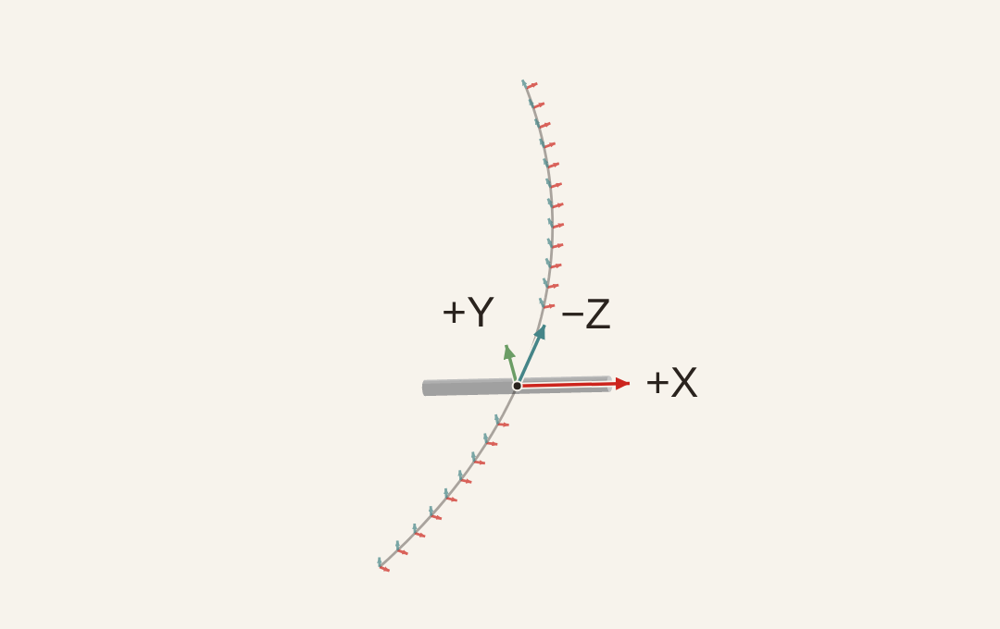
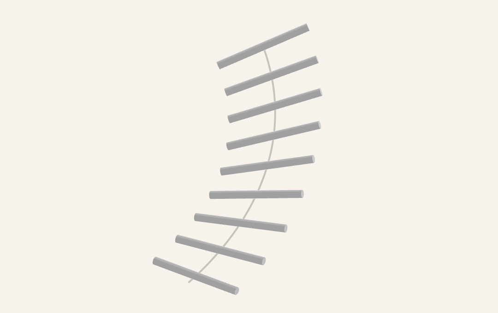
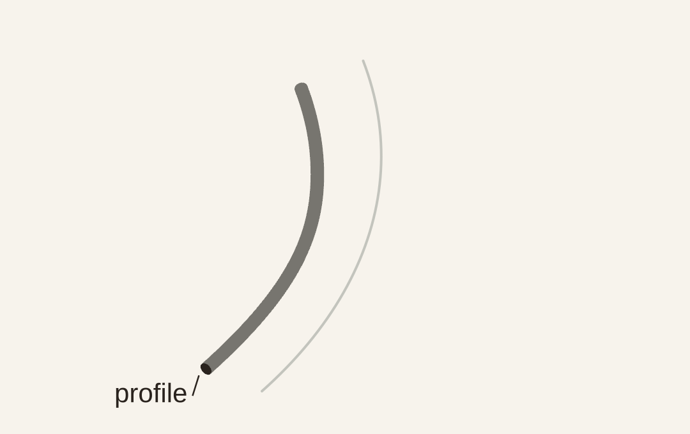
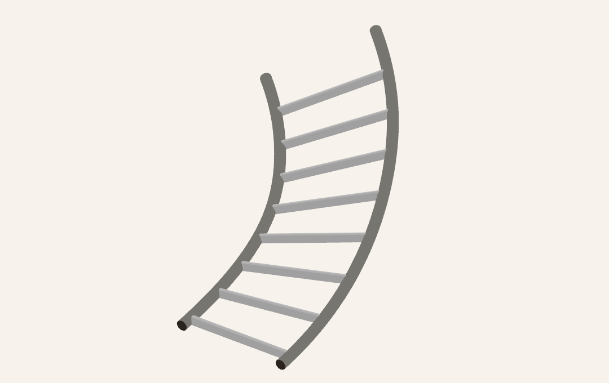
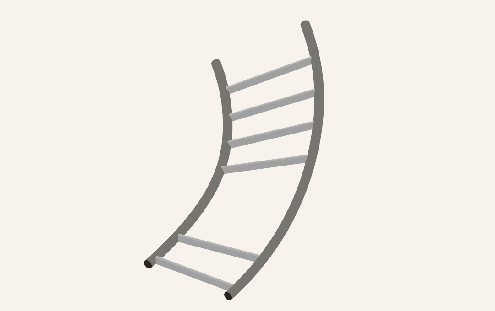

# recipe contract

<span id="construction-contract--placements"></span>A recipe places parts or sweeps profiles along a path. Contributors can share an asset with or without a recipe. Other tools can read the exported geometry without running the recipe or supporting its [operations](placement-reference.md).

Place a tie 2 m from the start of the path. [`sampleFrames`](placement-reference.md#sampleframes) gives a position and orientation there; [`instance`](placement-reference.md#instance) places the tie in that frame.

```ts
const frames = sampleFrames(path, [2]);
const result = instance(tie, frames);
```

<figure class="one-tie">
<picture>
  <source media="(prefers-color-scheme: dark)" srcset="assets/figures/one-tie-dark.png">
  
</picture>
</figure>

## repeated ties

Use [`repeat`](placement-reference.md#repeat) to space copies of the tie along the same path. The first tie stays 0.15 m from the start.

```ts
const spacing = 0.6;
const ties = repeat(tie, {
  path,
  spacing,
  startOffset: 0.15,
  allowed: [{ start: 0, end: 5 }],
});
```

<figure class="repeated-ties">
<picture>
  <source media="(prefers-color-scheme: dark)" srcset="assets/figures/curved-ties-dark.png">
  
</picture>
</figure>

## sweep a rail

Sample the one-tie path at its stations through `trackEnd`. Offset the frames sideways in local X, then [`sweep`](placement-reference.md#sweep) the profile. Use `metal` for the rail walls and end caps. The faint line is the path centerline.

```ts
const trackEnd = 5.00;
const stations = path.distances.filter(
  s => s <= trackEnd,
);
const frames = sampleFrames(path, stations);
const railFrames = offsetFrames(frames, {
  translation: [-0.60, 0, 0],
  rotation: [0, 0, 0, 1],
});
const rail = sweep(
  profile, railFrames, metal,
);
```

<figure class="swept-rail">
<picture>
  <source media="(prefers-color-scheme: dark)" srcset="assets/figures/swept-rail-dark.png">
  
</picture>
</figure>

## putting it together

Sweep both rails from the same stations and [`join`](placement-reference.md#join) them with the ties. Spacing changes only the ties. Leave the last tie station at least 0.06 m before the cut so its ends stay inside the rails.

```ts
const spacing = 0.6;
const trackEnd = 5.00;
const stations = [
  ...path.distances.filter(s => s < trackEnd),
  trackEnd,
];
const frames = sampleFrames(path, stations);
const leftFrames = offsetFrames(frames, {
  translation: [-0.60, 0, 0],
  rotation: [0, 0, 0, 1],
});
const rightFrames = offsetFrames(frames, {
  translation: [0.60, 0, 0],
  rotation: [0, 0, 0, 1],
});
const leftRail = sweep(
  profile, leftFrames, metal,
);
const rightRail = sweep(
  profile, rightFrames, metal,
);
const ties = repeat(tie, {
  path,
  spacing,
  startOffset: 0.15,
  allowed: [{ start: 0, end: trackEnd - 0.06 }],
});
const track = join([leftRail, rightRail, ties]);
```

<figure class="joined-track">
<picture>
  <source media="(prefers-color-scheme: dark)" srcset="assets/figures/joined-track-dark.png">
  
</picture>
</figure>

## leave a gap between ties

On the 5 m curve, set an `excluded` span from 1.1 m to `gapEnd`.

```ts
const gapEnd = 2.2;
const ties = repeat(tie, {
  path,
  spacing,
  startOffset: 0.15,
  allowed: [
    { start: 0, end: trackEnd - 0.06 },
  ],
  excluded: [{ start: 1.1, end: gapEnd }],
});
```

<figure class="tie-gap">
<picture>
  <source media="(prefers-color-scheme: dark)" srcset="assets/figures/tie-gap-dark.png">
  
</picture>
</figure>

Only the ties inside the span are left out. The rails and the remaining ties stay in place.
