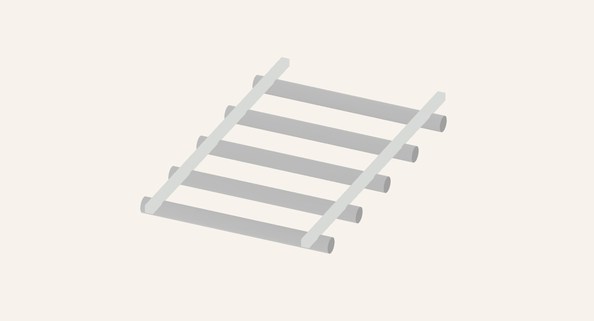

# recipe contract

<span id="construction-contract--placements"></span>A recipe places parts or sweeps profiles along a path. Contributors can share an asset with or without a recipe.

This [one-tie example](examples/one-tie.ts) starts 2 m along the path. [`sampleFrames`](placement-reference.md#sampleframes) gives a position and orientation there; [`instance`](placement-reference.md#instance) places the tie in that frame. The labeled arrows mark the frame.

```ts
const frames = sampleFrames(path, [2]);
const result = instance(tie, frames);
```

<figure class="one-tie">
<picture>
  <source media="(prefers-color-scheme: dark)" srcset="assets/figures/one-tie-dark.png">
  
</picture>
</figure>

The tie banks with the path.

## repeated ties

Place copies of the Blitz `tie` along `trackPath` on a straight 1.95 m track. Use [`repeat`](placement-reference.md#repeat) to space them evenly. The first tie stays 0.15 m from the start as the spacing changes.

```ts
const spacing = 0.4;
const result = repeat(tie, {
  path: trackPath,
  spacing,
  startOffset: 0.15,
  allowed: [{ start: 0, end: 1.951 }],
});
```

<figure class="repeated-ties">
<picture>
  <source media="(prefers-color-scheme: dark)" srcset="assets/figures/repeated-ties-dark.png">
  
</picture>
</figure>

Run only recipes you trust. Run [`bun examples/repeated-tie.ts`](examples/repeated-tie.ts) from the repository root to export `repeated-ties.gltf`.

A recipe’s result can be exported as geometry. Tools that read the export don’t need to run the recipe or support the [operations it calls](placement-reference.md).
