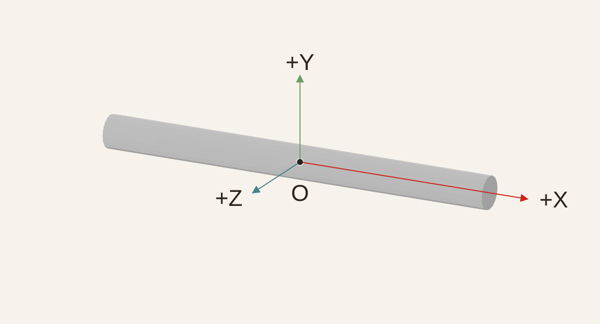
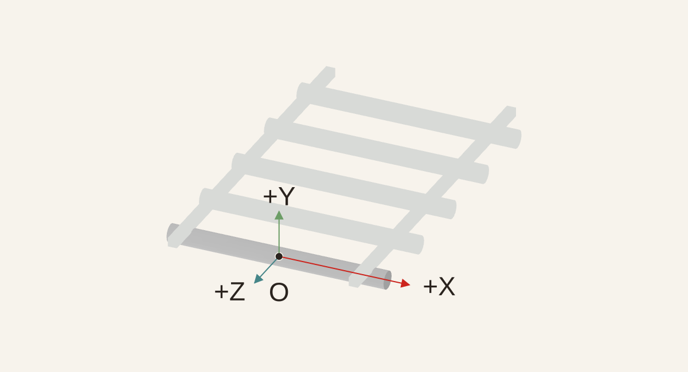

# parts

A part defines reusable geometry, materials and hierarchy. A
[recipe](construction-contract.md) can place a part without changing its definition.

<picture>
  <source media="(prefers-color-scheme: dark)" srcset="assets/figures/tie-frame-dark.png">
  
</picture>
<picture>
  <source media="(prefers-color-scheme: dark)" srcset="assets/figures/tie-context-dark.png">
  
</picture>

