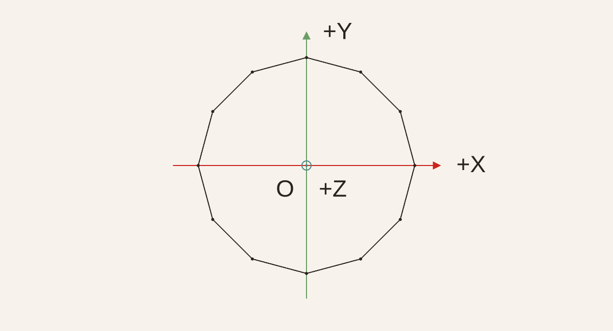
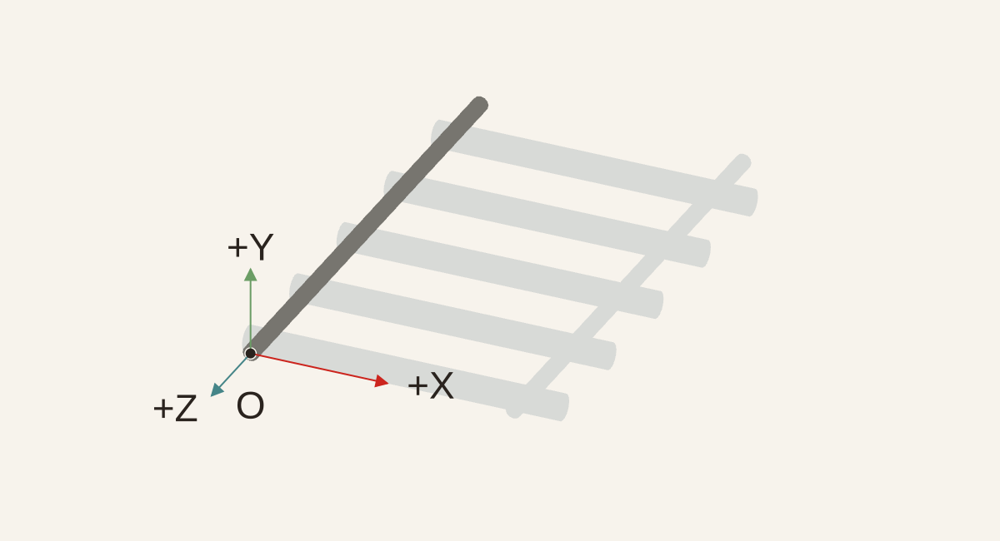

# profiles

Profiles define cross-sections, such as the shape of a rail. A
sweep carries a profile along a
path to generate geometry.

<picture>
  <source media="(prefers-color-scheme: dark)" srcset="assets/figures/profile-dark.png">
  
</picture>
<picture>
  <source media="(prefers-color-scheme: dark)" srcset="assets/figures/profile-extrusion-dark.png">
  
</picture>

